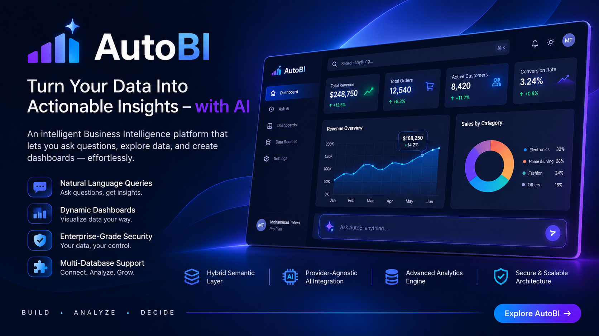
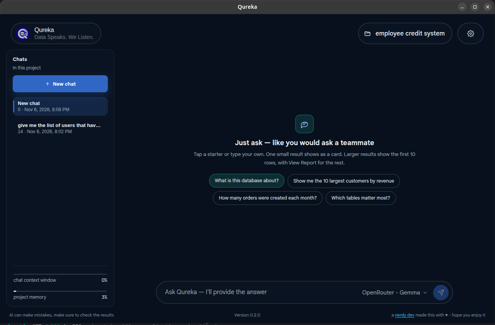
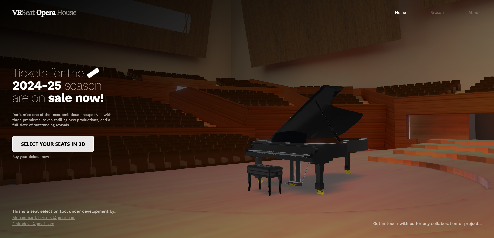
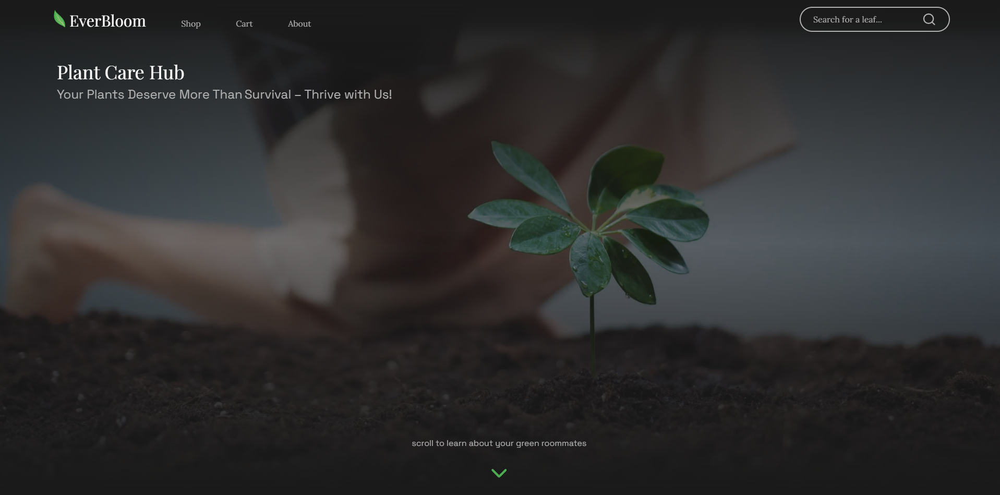
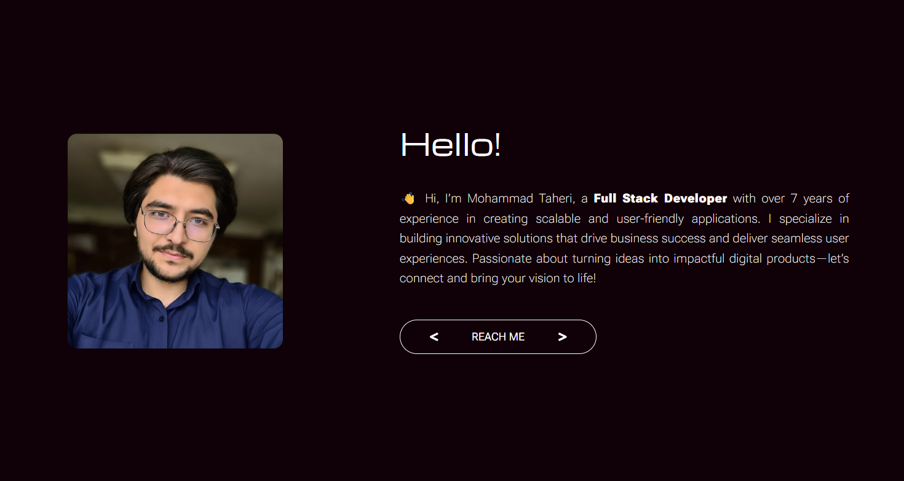

# Mohammad Taheri
### Senior Full-Stack Engineer | Enterprise Software | AI-Powered Products

I design and build scalable software systems, from architecture and backend infrastructure to polished user interfaces and production deployment.

With **7+ years of software development experience**, I specialize in full-stack engineering, enterprise application architecture, business process automation, and AI-powered software products.

I enjoy solving complex engineering problems, turning ideas into practical products, and building software that is maintainable, reliable, and useful.

  
  
  

---

## About Me

- **Full-Stack Engineering:** Experienced in designing and developing complete applications using modern JavaScript and TypeScript ecosystems.
- **System Architecture:** Interested in modular architectures, scalable backend systems, database design, and maintainable software.
- **Enterprise Software:** Experience building business applications, ERP-related systems, reporting platforms, and business process management solutions.
- **AI Engineering:** Building AI-powered products with a focus on practical integrations, structured outputs, database intelligence, and application-level security.
- **Product Development:** Comfortable taking products from initial concepts and technical planning to implementation and deployment.
- **Technical Leadership:** Experience contributing to software architecture, technical decisions, development processes, and team coordination.

I believe good software engineering is not just about writing code. It is about understanding problems, making sound technical decisions, and delivering solutions that work in the real world.

---

## Technical Expertise

### Languages & Frameworks

  

- TypeScript & JavaScript
- React & Next.js
- NestJS & Node.js
- Express.js
- Python & C#

### Backend & Data Engineering

  

- REST API design and development
- Backend architecture and modular application design
- PostgreSQL, MySQL, SQLite
- Prisma ORM
- Database modeling and optimization
- Authentication, authorization, and RBAC
- SQL query design and execution
- Multi-tenant application architecture

### Frontend & UI Engineering

  

- Modern React and Next.js applications
- Responsive and accessible interfaces
- Component-driven architecture
- Design systems and reusable UI components
- Advanced animations and interactions
- Three.js and interactive 3D experiences
- Performance optimization

### AI & Intelligent Applications

- LLM API integration
- AI-powered application development
- Natural-language-to-SQL workflows
- Structured AI outputs and validation
- Database intelligence and semantic layers
- Retrieval and contextual data processing
- AI provider abstraction and BYOK architectures

### Infrastructure & Engineering Tools

  

- Linux server administration
- Docker and containerized deployment
- Git and GitHub workflows
- CI/CD pipelines
- Application deployment and maintenance
- Production troubleshooting

---

## Featured Projects

### 1. AutoBI — AI-Powered Business Intelligence

[GitHub Repository](https://github.com/MTaheridev/AutoBI)

**An intelligent analytics platform that transforms natural-language questions into database-driven dashboards and insights.**

  

- Designed an architecture around database intelligence, AI query generation, and dashboard generation.
- Supports a provider-independent AI integration approach.
- Uses a hybrid semantic layer to connect business concepts with database structures.
- Focuses on separating AI-generated analytical logic from deterministic application-level validation and execution.
- Designed to work with multiple database technologies.

**Focus:** AI engineering, database intelligence, analytics architecture, full-stack development.

**Status:** Version 1.0.0 released.

---

### 2. Qureka — AI Database Reporting Assistant

[GitHub Repository](https://github.com/MTaheridev/Qureka)

**A desktop-oriented AI application that makes database reporting accessible through natural-language interaction.**

  

- Ask questions in natural language and generate database-driven insights.
- Supports multiple database engines, including PostgreSQL, MySQL, SQL Server, and SQLite.
- Uses read-only database access and SQL guardrails.
- Provides report export capabilities in CSV, Excel, and PDF formats.
- Combines a modern application interface with AI-assisted data analysis.

**Tech:** Electron, Next.js, TypeScript, Prisma, PostgreSQL, MySQL, MSSQL, SQLite.

**Focus:** Desktop application development, AI integration, database engineering, application security.

**Status:** Version 1.0.0 released.

---

### 3. VRSeat — Interactive 3D Concert Hall

[Live Demo](https://3d-concert-hall.vercel.app/)

**An interactive 3D concert hall experience with immersive seat selection.**

  

- Interactive 3D environment and seat selection.
- Custom animations and transitions.
- Immersive lighting and visual effects.
- Responsive, touch-friendly user experience.

**Role:** Lead Frontend Developer & 3D UX Designer.

**Tech:** Next.js, React, Three.js, Tailwind CSS.

---

### 4. Everbloom — Plant E-commerce Platform

[Live Demo](https://everbloom-mt.vercel.app/)

**A modern e-commerce experience for discovering and shopping for indoor plants.**

  

- Product discovery, search, and filtering.
- Responsive product browsing experience.
- Shopping cart and checkout functionality.
- Custom interface and reusable components.

**Role:** Full-Stack Developer.

**Tech:** Next.js, TypeScript, Tailwind CSS.

---

### 5. Personal Portfolio

[Visit Website](https://taheri.vercel.app/)

**My personal portfolio and professional online presence.**

  

- Custom-designed visual identity.
- Interactive sections and motion-driven experiences.
- Responsive layouts and performance-conscious implementation.
- Project showcases and professional information.

**Role:** Designer & Developer.

**Tech:** Next.js, Tailwind CSS, Framer Motion.

---

### 6. Solo Weather — Weather Application

[Live Demo](https://solo-weather.vercel.app/)

A lightweight weather application focused on presenting current weather information through a simple, intuitive interface.

**Tech:** React, OpenWeatherMap API, Tailwind CSS.

---

## Professional Experience

### Software Lead / ProcessMaker Specialist
**Rabin Samane Pars**

Working on enterprise software solutions, business process management, and digital transformation initiatives.

Key areas of involvement:

- Enterprise application development and architecture.
- Business process automation and workflow management.
- ProcessMaker customization and integration.
- Reporting systems and database-driven applications.
- Technical coordination and development process improvement.
- Designing solutions for complex organizational structures and business requirements.

### Independent Software Development

Experience designing and delivering full-stack applications, interactive web experiences, and custom software solutions.

Areas of work include:

- Frontend and backend application development.
- Database architecture and API engineering.
- UI/UX implementation.
- Performance optimization.
- Application deployment and maintenance.

---

## Education

**B.Sc. in Computer Engineering**

Islamic Azad University — Mashhad, Iran  
2017–2021

---

## Additional Experience

- Programming education and mentoring.
- Python programming certification — Technical and Vocational Training Organization of Iran (2024).
- Experience working with business process management platforms.
- Experience with enterprise reporting and database-driven applications.

---

## Let's Connect

I'm interested in challenging engineering problems, building meaningful products, and collaborating with teams working on ambitious software systems.

  <a href="https://taheri.vercel.app/">Portfolio</a> ·
  <a href="https://github.com/MTaheridev">GitHub</a> ·
  <a href="https://www.linkedin.com/in/mohammad-taheri-6b5ba0241">LinkedIn</a> ·
  <a href="mailto:Mohammadtaheri.dev@gmail.com">Email</a>

  <i>Making concepts come true.</i>

